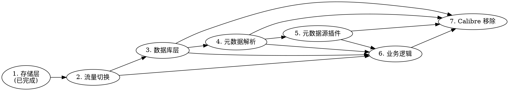

# Talebook 后端全量迁移到 Go booksvr —— 迁移路线图

> 本文件是设计模式产出的**唯一审批文档**，同时包含需求分析、概要设计与实施计划。
>
> **文档定位：总纲级路线图。** 用户 2026-10-10 明确选择「只写阶段划分、每阶段目标/验收口径/风险/依赖，不写逐步实施项」。每个阶段真正开工时，再单独产出一份含 TDD 步骤的可执行 `plans/*.md`。
>
> **落地形态（用户 2026-10-10 确认）：** 只产出本 `plans/*.md` 路线图，**不转写为 `design/` HTML**。每个阶段落地时各自产出对应的 `design/<module>/yyyymmdd-<feature>.wip.html`。

---

## User Request

**原始需求（用户原话）：**

> 我的目标从来都是替换 calibre，整个 talebook 的后端换成 go 的 booksvr 呀

> 岂有此理，没有被调用，booksvr 还有什么用。目标就是替换 calibre，只是部分功能没实现而已

**已澄清信息（2026-10-10 AskUser 三问）：**

| # | 问题 | 用户决策 |
|---|---|---|
| 1 | 路线图落地形态 | **只产出 `plans/*.md` 路线图，不转写 `design/` HTML** |
| 2 | 路线图粒度 | **总纲级**：只写阶段划分、每阶段目标/验收口径/风险/依赖，不写逐步实施项 |
| 3 | 下一阶段优先做哪个 | **流量切换**：让 Tornado 把路由代理给 booksvr（或直接换掉 Tornado） |

**第一阶段保留（用户 2026-10-10 确认）：**

- `plans/2026-10-07-calibre-go-rewrite.md` —— 不推翻，作为整个迁移的**第一阶段**成果。
- `design/booksvr/20261007-calibre-go-rewrite.active.html` —— 不推翻，已 ACTIVE。

**用户偏好/约束（继承第一阶段，仍然有效）：**

- 数据安全优先于自动化程度；「自动 + 人工兜底」。
- 繁简统一用内置精简对照表，反对 Calibre 32 万行 `unihandecode`。
- 「版本」定义：同一本书的不同版次、出版社、格式；作者和书名相同即同一本书。
- 前端 Nuxt 零改动是硬验收口径（多目录 UI 为唯一例外）。
- 开发在 fork 仓库 `leonzy/talebook` 的 `feat/booksvr-calibre-rewrite` 分支进行。
- 整篇写完再一次性审查。

---

## Goal

把 Talebook 后端从 Python（Tornado + Calibre）**全量迁移**到 Go 的 `booksvr`，最终彻底移除 Calibre 运行时依赖，并让 `booksvr` 成为唯一在生产的后端进程。本路线图给出 7 个阶段的划分（阶段 1 已完成，阶段 2-7 待推进）、每阶段的目标/验收口径/风险/依赖，以及阶段间的依赖顺序与推荐执行顺序。

---

## Non-Goals

- **不重写 Calibre 的 107,281 行转换引擎。** 格式转换继续调用外部 `ebook-convert`（`webserver/services/convert.py:22` 的 `EBOOK_CONVERT_CMD`，经 `subprocess.Popen` 在 `convert.py:158` 调用；或后续单独评估替代方案），本路线图不覆盖。
- **不改变对外 HTTP API 契约。** 218 条路由的路径、方法、响应结构在迁移全程保持不变；前端 Nuxt 除多目录 UI 外零改动。
- **不改变「版本」的领域定义。** 沿用第一阶段锁定的作品/版本/格式三层模型。
- **不在本路线图内写逐步实施项。** 每个阶段的 TDD 步骤在其各自的 `plans/*.md` 中给出。
- **不做与迁移无关的重构。** 不顺手清理 `webserver/` 中与 Calibre 解耦无关的代码。

---

## Current Codebase Facts

> 以下全部为 2026-10-10 实测核实，非推测。

### 规模对比

| | Python 后端 | Go booksvr |
|---|---|---|
| 代码量 | **40,246 行 / 191 文件** | **9,309 行 / 45 文件** |
| 路由 | 215 条（Tornado 实际服务） | 218 条（215 镜像 + 3 新增，**已声明**） |
| Calibre 耦合 | **23 个文件 `import calibre`（合计 8,539 行）** | 0（纯 Go） |
| 含 calibre 字样文件 | 49 个 | — |

### 接管进度（关键澄清）

| 层 | 状态 | 证据 |
|---|---|---|
| **格式路径解析** | ✅ **已真实接管** | `webserver/services/format_keys.py` 的 `apply_format_keys()` 被 `handlers/base.py:611` 的 `get_books()` 与 `webdav/dav_provider.py:225` 调用，读 `book_formats` 表 |
| **218 条路由** | ⚠️ **已声明，未接管流量** | `booksvr/internal/httpapi/routes.go` 注册 215+3 条；`server.py` → `webserver.main.main()` 启动的仍是 Tornado；Dockerfile 只 `COPY --from=go-builder /out/booksvr /usr/local/bin/booksvr` |
| **Go 侧已实现的 handler** | ⚠️ **仅 3 条** | `booksvr/internal/httpapi/workroutes.go` 的 `WorkRouteSpecs()` 返回 3 条；其余 215 条在 `NewServer` 中因 `Handler == nil` 被跳过 |
| **数据库读写** | ❌ 仍走 Calibre | `main.py:210` `LibraryDatabase(...)`；`handlers/base.py:268` `self.db = self.settings["legacy"]` |
| **元数据解析** | ❌ 仍走 Calibre | `calibre.ebooks.metadata.meta.get_metadata/set_metadata`（`book.py:1419,2444`、`scan.py:232,526`、`base.py:556`）|
| **元数据源插件** | ❌ 仍走 Calibre | `plugins/meta/calibre/api.py` 注册 Amazon/Google/OpenLibrary/BigBookSearch/Edelweiss/GoogleImages |
| **业务逻辑** | ❌ 仍在 Python | 用户/书架/笔记/有声书/插件平台/OPDS/WebDAV，约 30,000 行 |
| **转换引擎** | ❌ 明确不做 | 107,281 行，本路线图 Non-Goal |

### 进程与部署现状

| 事实 | 位置 |
|---|---|
| Tornado 启动入口 | `server.py` → `webserver.main.main()` |
| Tornado 监听参数 | `conf/supervisor/talebook.conf`：`python3 server.py --with-library=/data/books/library --port=8000 --host=127.0.0.1` |
| supervisor 程序组 | `nginx, bootstrap, tornado, upgrade`；`tornado` 由 `bootstrap` 自检通过后拉起 |
| Nginx 反代 | `location ~ ^/(api\|get\|read\|read-comic\|opds\|auth\|books\|media)/` → `proxy_pass http://tornado`（`conf/nginx/talebook.conf:82-92`）；另有 `/podcast/v1/`、`/read/resource/`、`/read-online-comic` 独立代理 |
| booksvr 二进制 | Dockerfile `COPY --from=go-builder /out/booksvr /usr/local/bin/booksvr`，**仅拷入，无进程启动它** |
| booksvr CLI 子命令 | `import-calibre`、`reindex-normalize`（`cmd/booksvr/main.go`），**无 `serve` 子命令** |

### Calibre 依赖分类（23 文件 / 8,539 行）

| 类别 | 依赖内容 | 代表文件 |
|---|---|---|
| 数据库层 | `calibre.db.backend.DB`、`calibre.db.legacy.LibraryDatabase` | `main.py:102,124,207` |
| 元数据解析 | `calibre.ebooks.metadata.meta.get_metadata/set_metadata`、`opf2` | `book.py:1419,2444`、`scan.py:232,526`、`base.py:556`、`files.py:90` |
| 元数据源插件 | Amazon / Google / OpenLibrary / Big Book Search / Edelweiss / GoogleImages | `plugins/meta/calibre/api.py` |
| 元数据对象 | `calibre.ebooks.metadata.book.base.Metadata` | 11 个 meta 插件 + `scan.py` + `booksource/*` |
| 工具函数 | `guess_type`、`as_utc`、`comments_to_html`、`tweaks`、`ascii_text`、`ascii_filename`、`authors_to_string`、`fmt_sidx`、`prepare_string_for_xml`、`sort_key`、`SortKey/SortKeyGenerator`、`_html4_parse`、`gui2`、`sendmail`、`magick.draw.thumbnail` | `opds.py:15-22`、`utils.py:53`、`base.py:398`、`mail.py:44,87`、`files.py:66`、`convert.py:71` |
| 回收站 | `cache.list_trash_entries()`、`cache.delete_trash_entry()` | `base/trash_manager.py` |

### 既有模式

- 后端 JSON 接口统一 `@js` + `@auth` 装饰器，返回 `{"err": "ok", ...}`。
- 路由遵循 RESTful：单数资源名，动作作为子路径。
- 内部方案落在 `design/<module>/yyyymmdd-<feature>.<status>.html`，单文件离线 HTML，8 节结构。
- 领域规格落在 `spec/`，改变产品行为必须在同一 PR 更新对应篇目。
- `booksvr` 包边界：`normalize` 不依赖 DB；`library` 不依赖 HTTP；`httpapi` 不直接写 SQL；`migrate` 只读源库。

---

## Proposed Design

### 总体策略：绞杀者模式（Strangler Fig）

不重写、不替换，而是**逐层把流量从 Python 切到 Go**，每一层切换后 Python 侧对应代码退化为「不再被调用的死代码」，最后整体删除。

```
现状：  Nginx → Tornado(215 路由) → Calibre(DB/元数据/插件) + Python 业务逻辑
                    ↑
              booksvr 只接管了「格式路径解析」这一层

终态：  Nginx → booksvr(218 路由) → SQLite(自有 schema) + Go 业务逻辑
                    ↑
              Calibre 完全不在运行时
```

**为什么是绞杀者而非一次性重写：** 30,000 行业务逻辑 + 8,539 行 Calibre 耦合，一次性重写无法验证、无法回滚。绞杀者让每一层都能独立灰度、独立回滚，且每切一层都有可观测的收益。

### 阶段划分总览

| 阶段 | 名称 | 目标 | 规模 | 依赖 |
|---|---|---|---|---|
| **1** | Calibre 存储层 Go 重写 | 作品/版本/格式三层模型 + 归一化 + 迁移 | 已完成 | — |
| **2** | 流量切换 | 让 booksvr 真正提供 HTTP 服务 | 中 | 阶段 1 |
| **3** | 数据库层接管 | booksvr 直连 SQLite，替换 `calibre.db.*` | 中 | 阶段 2 |
| **4** | 元数据解析接管 | EPUB/MOBI/PDF 元数据读写，替换 `calibre.ebooks.metadata.*` | 大 | 阶段 3 |
| **5** | 元数据源插件接管 | Amazon/Google/OpenLibrary 等 | 中 | 阶段 4 |
| **6** | 业务逻辑接管 | 用户/书架/笔记/有声书/插件平台/OPDS/WebDAV | 很大 | 阶段 2-5 |
| **7** | Calibre 运行时移除 | 删除 `import calibre`、基础镜像瘦身 | 中 | 阶段 3-6 |

> **注：** 阶段 7 是「收尾验证」而非独立开发阶段——它的每一项都是前序阶段完成后的删除动作。单列出来是为了让「彻底摆脱 Calibre」这个用户目标有明确的验收锚点。

### 阶段依赖关系



**关键依赖说明：**

- **阶段 2 是唯一的硬前置。** 在 booksvr 能提供 HTTP 服务之前，阶段 3-6 的任何成果都无法被真实流量验证。
- **阶段 3 → 4 → 5 是严格串行。** 元数据解析依赖数据库层（要写回 `books`/`book_formats`）；元数据源插件依赖元数据解析（要构造 `Metadata` 对象）。
- **阶段 6 可以与 3/4/5 并行推进**，但每一条业务路由的接管都依赖它所需的下层能力已就绪（例如「导入」路由依赖阶段 4，「元数据搜索」路由依赖阶段 5）。
- **阶段 7 依赖 3-6 全部完成**，因为只要还有一处 `import calibre`，就不能移除运行时。

### 推荐执行顺序

用户已选择**阶段 2（流量切换）**作为下一阶段。推荐理由：

1. **它是当前最大的「悬空」。** 218 条路由已声明、3 条已实现，但没有任何进程把流量导给它——代码写完了却不在生产路径上。这是「booksvr 还有什么用」这个质疑的直接答案。
2. **它是所有后续阶段的验证前提。** 阶段 3-6 的成果必须通过真实 HTTP 流量验证，否则只能停留在单元测试层面。
3. **风险可控、可灰度。** 可以先让 booksvr 只接管已实现的 3 条路由，其余继续由 Tornado 服务；确认无误后逐步扩大。
4. **它不需要先解决 Calibre 依赖。** 阶段 2 只解决「谁提供 HTTP」，不触碰「数据从哪来」——booksvr 可以继续读同一个 SQLite 库。

**阶段 2 之后推荐顺序：** 3（数据库层）→ 4（元数据解析）→ 5（元数据源插件）→ 6（业务逻辑，可与 3-5 部分并行）→ 7（Calibre 移除）。

---

## 阶段详述

### 阶段 1：Calibre 存储层 Go 重写（已完成，保留）

**目标：** 建立作品/版本/格式三层模型、8 步归一化流水线、Calibre 单向只读迁移，并接管格式路径解析层。

**已交付：**

- `booksvr/internal/{normalize,library,migrate,httpapi,reindex}` 五个包，9,309 行 / 45 文件。
- 218 条路由注册表（215 镜像 + 3 新增）+ 字段兼容层（`compat.go`）。
- 3 条 work/versions/merge 路由的 handler 与 HTTP 服务器骨架（`server.go`）。
- 格式路径解析已真实接管（`format_keys.py`，覆盖率 100%）。
- `import-calibre`、`reindex-normalize` 两个 CLI 子命令。

**验收口径（已达成）：**

- `go test ./...` 6 包全绿；`go vet` / `gofmt -l` 无输出。
- `internal/normalize` 100%、`httpapi` 99.6%、`library` 87.6%、`migrate` 90.1%、`reindex` 94.9% 覆盖率。
- `pytest tests/test_booksvr_contract.py` 26 passed；`check_design_docs.py` 171 篇通过；`check_spec.py` 25 篇通过。
- 真实后端镜像构建成功、启动成功、浏览器实测 7 步通过。

**遗留缺口（如实记录）：**

- 前端零改动全流程回归、`interface-review`、`make build` 镜像构建——均需 Docker Hub 可达。
- 218 条路由中仅 3 条有 Go handler，其余 215 条是「已声明未实现」。

**产出物：** `plans/2026-10-07-calibre-go-rewrite.md`、`design/booksvr/20261007-calibre-go-rewrite.active.html`。

---

### 阶段 2：流量切换（下一阶段）

**目标：** 让 `booksvr` 成为真正提供 HTTP 服务的进程，把已实现的路由从 Tornado 切到 booksvr，并建立可灰度、可回滚的切换机制。

**核心问题：** booksvr 目前**没有 `serve` 子命令**，`server.go` 的 `Server` 只被测试使用（`httptest.NewServer`），没有任何生产入口。

**需要解决的关键设计问题（本阶段开工时需先澄清）：**

1. **切换方式：代理 vs 替换。**
   - **方案 A（代理）：** Tornado 保留为前端，把已实现的路由反向代理给 booksvr（booksvr 监听另一个端口）。优点：灰度粒度细、回滚只需改代理表；缺点：多一跳、两套进程并存。
   - **方案 B（替换）：** booksvr 直接监听 8000，Tornado 下线。优点：架构干净；缺点：215 条未实现路由无人服务，必须一次性全部实现或保留 Tornado 兜底。
   - **方案 C（混合）：** booksvr 监听 8000 作为主入口，未实现的路由反向代理回 Tornado。优点：booksvr 成为唯一对外入口，未实现路由平滑兜底；缺点：需要 booksvr 侧实现代理逻辑。
   - **推荐 C**：它让「booksvr 是后端」这一事实成立，同时不阻塞在「215 条全部实现」上。

2. **身份与权限如何传递。** booksvr 的 `Identity`（`server.go`）需要从 Tornado 的 session/cookie 解析。方案 A/C 下需要定义 Tornado → booksvr 的身份传递协议（如内部 header + 共享密钥）。

3. **数据库连接。** booksvr 需要打开同一个 SQLite 库。阶段 2 可以先只读，写操作仍走 Tornado。

**验收口径：**

- [ ] `booksvr serve` 子命令存在，可监听指定端口，`--help` 有说明。
- [ ] 已实现的 3 条路由（`/api/work/{id}`、`/api/book/{id}/versions`、`/api/book/{id}/merge`）通过 booksvr 真实提供，响应结构与单元测试断言一致。
- [ ] 未实现的路由有明确兜底路径（代理回 Tornado 或返回明确的未实现错误），**不得静默 404**。
- [ ] 灰度开关存在：可以按路由前缀或路由清单控制「哪些走 booksvr、哪些走 Tornado」。
- [ ] 回滚方式明确且已验证：关闭开关后流量完全回到 Tornado，行为与切换前一致。
- [ ] 端到端验证：真实 Docker 后端 + 浏览器，登录、书库、详情、阅读、书架全流程可用。
- [ ] 契约测试扩展：对已切换的路由，逐字段比对 booksvr 与 Tornado 的响应。

**风险：**

| 风险 | 影响 | 缓解 |
|---|---|---|
| 身份传递不安全 | 越权访问 | 内部 header + 共享密钥；booksvr 不信任外部传入的身份 |
| 两套进程并存导致状态不一致 | 数据错乱 | 阶段 2 只读；写操作仍走 Tornado |
| 灰度开关本身有 bug | 流量丢失 | 开关默认「全部走 Tornado」，逐条开启 |
| 未实现路由静默 404 | 前端功能缺失且难排查 | 兜底必须显式，且记录日志 |
| 端口/进程管理复杂化 | 部署失败 | supervisor 配置需同步更新并测试 |

**依赖：** 阶段 1（已完成）。

**产出物：** 一份新的 `plans/*.md`（含 TDD 步骤）+ `design/booksvr/yyyymmdd-booksvr-serve.wip.html`。

---

### 阶段 3：数据库层接管

> **⚠️ 2026-10-10 路线修正（用户确认）：** 本阶段原定义「让 Python 换个方式读库」建立在错误前提上——**Python 注定要删，给它做数据层优化是浪费**。
>
> 用户原话：「**为什么还要python？**」
>
> **修正后的定义：** 本阶段改为「**在 Go 里把数据访问层建完整（读+写）**」，作为搬 handler 的基础设施，**不碰 Python 的数据访问代码**。Python 侧的数据访问代码随阶段 6 的 handler 搬迁一起删除。
>
> 原「先切读后切写」方案作废（已删除 `plans/2026-10-10-db-layer.md`）。

**目标：** 在 Go 里实现完整的数据访问层（读+写），替换 `calibre.db.backend.DB` 与 `calibre.db.legacy.LibraryDatabase` 的能力，供阶段 6 的 handler 直接使用。

**核心问题：** 目前 `handlers/base.py:268` 的 `self.db = self.settings["legacy"]` 是 Calibre 的 `LibraryDatabase`，所有 `self.db.get_data_as_dict()` / `get_metadata()` / `add_format()` / `import_book()` / `search_getting_ids()` / `get_books_for_category()` / `books_with_same_title()` 都走它。

**需要解决的关键设计问题：**

1. **替换方式：Go 提供 API vs Python 直连新 schema。**
   - **方案 A：** booksvr 提供内部数据 API，Python 通过 HTTP 调用。优点：单一数据所有者；缺点：每次查询多一跳，性能敏感路径（书库列表）受影响。
   - **方案 B：** Python 直接读新 schema（`books` + `works` + `book_formats`），用 SQLAlchemy 或原生 SQL。优点：无额外跳数；缺点：两套代码同时写库，一致性风险。
   - **方案 C：** 分阶段——读操作先切（Python 直读新 schema），写操作后切（走 booksvr API）。
   - **推荐 C**：读多写少，先切读能覆盖大部分收益且风险低。

2. **Calibre 高频方法的等价实现。** 需逐一实现：`get_data_as_dict`、`get_metadata`、`new_api`、`field_metadata`、`add_format`、`import_book`、`get_books_for_category`、`books_with_same_title`、`search_getting_ids`、`format_abspath`、`cover`、`sizeof_format`、`all_book_ids`、`delete_book`、`set_tags`、`sort`。

3. **搜索语义。** Calibre 的 `search_getting_ids` 支持 `publisher:'x'`、`author:'x'`、`tag:'x'` 等查询语法。需要在新 schema 上复刻等价语义。

4. **回收站。** `base/trash_manager.py` 依赖 `cache.list_trash_entries()` / `delete_trash_entry()`，需要新实现。

**验收口径：**

- [ ] `booksvr` 提供书库读写的等价能力，覆盖上述 16 个高频方法。
- [ ] Python 侧 `self.db` 不再指向 Calibre `LibraryDatabase`。
- [ ] 搜索语义等价：`publisher:'x'`、`author:'x'`、`tag:'x'`、`format:'x'` 的查询结果与 Calibre 一致。
- [ ] 回收站功能可用：列出、恢复、永久删除。
- [ ] 契约测试：对同一测试书库，Python 版与 Go 版的查询结果逐条一致。
- [ ] 性能不劣化：书库列表、搜索的响应时间不超过 Calibre 版。
- [ ] 数据安全：迁移与切换过程可回滚，源库不被破坏。

**风险：**

| 风险 | 影响 | 缓解 |
|---|---|---|
| 搜索语义不完全等价 | 用户搜不到书 | 逐查询语法建对照测试 |
| 两套代码同时写库 | 数据不一致 | 阶段 3 先只切读，写仍走 Calibre |
| 性能劣化 | 大库不可用 | 建基准测试，对比 Calibre |
| 回收站行为差异 | 误删/无法恢复 | 专项测试 + 人工兜底 |

**依赖：** 阶段 2。

**产出物：** 一份新的 `plans/*.md` + `design/booksvr/yyyymmdd-db-layer.wip.html`。

---

### 阶段 4：元数据解析接管

**目标：** 用 Go 实现 EPUB/MOBI/PDF/TXT/CBZ 等格式的元数据读写，替换 `calibre.ebooks.metadata.meta.get_metadata/set_metadata` 与 `opf2`。

**核心问题：** 导入、扫描、保存元数据三条路径都依赖 Calibre 解析文件元数据。

**需要解决的关键设计问题：**

1. **格式覆盖优先级。** EPUB（ZIP + OPF）最容易；MOBI/AZW3（PalmDOC + EXTH）中等；PDF（XMP/Info 字典）较难；TXT/CBZ 无内嵌元数据（从文件名提取）。
2. **元数据字段范围。** 需覆盖 `webserver/utils.py:66-170` 的约 25 个展示字段 + 写回所需字段（title/authors/tags/comments/publisher/pubdate/series/language/isbn/identifiers/cover）。
3. **`Metadata` 对象语义。** Python 侧大量代码依赖 `calibre.ebooks.metadata.book.base.Metadata` 对象（含 `smart_update()`、自定义列）。需要决定：Go 侧提供等价对象，还是 Python 侧改用轻量 dict。
4. **写回格式。** `set_metadata` 需要把元数据写回 EPUB/MOBI 文件本身，这是有损风险的操作，需要备份与回滚。

**验收口径：**

- [ ] Go 侧可读取 EPUB/MOBI/AZW3/PDF/TXT/CBZ 的元数据，字段与 Calibre 解析结果一致。
- [ ] Go 侧可把元数据写回 EPUB/MOBI，写回后 Calibre 仍能正确读取（交叉验证）。
- [ ] 导入路径（`scan.py`、`book.py:1419`）不再调用 `calibre.ebooks.metadata.meta`。
- [ ] 保存元数据路径（`base.py:556`、`convert.py:244`）不再调用 Calibre。
- [ ] OPF 生成（`files.py:90` 的 `metadata_to_opf`）有 Go 等价实现。
- [ ] 写回操作有备份与回滚，失败不损坏源文件。
- [ ] 契约测试：对同一批测试文件，Go 与 Calibre 的解析结果逐字段一致。

**风险：**

| 风险 | 影响 | 缓解 |
|---|---|---|
| 格式解析不完整 | 元数据缺失/错误 | 逐格式建对照测试，覆盖真实样本 |
| 写回损坏文件 | 用户数据丢失 | 强制备份 + 写回后校验 + 可回滚 |
| `Metadata` 对象语义差异 | 大量调用点行为变化 | 先建等价对象，再逐点替换 |
| 编码/字符集问题 | 中文乱码 | 专项测试中文样本 |

**依赖：** 阶段 3。

**产出物：** 一份新的 `plans/*.md` + `design/booksvr/yyyymmdd-metadata-parse.wip.html`。

---

### 阶段 5：元数据源插件接管

**目标：** 用 Go 实现 Amazon/Google/OpenLibrary/Big Book Search/Edelweiss/GoogleImages 元数据源，替换 `plugins/meta/calibre/api.py`。

**核心问题：** `plugins/meta/calibre/api.py` 通过 Calibre 的 `identify` 框架查询外部元数据源。

**需要解决的关键设计问题：**

1. **是否保留 Calibre 元数据源。** 这些源（Amazon/Google/OpenLibrary）本身是公开 API，可以独立实现；但 Calibre 的实现包含大量反爬、限流、解析逻辑。
2. **与现有 Talebook 元数据插件的关系。** Talebook 已有自己的元数据插件体系（`plugins/meta/{douban_v2,neodb,baike,...}`），它们也依赖 Calibre 的 `Metadata` 对象。阶段 5 需要统一这两套。
3. **`identify` 框架的等价实现。** 包括 `wait_after_first_identify_result`、`patch_plugins`、封面来源等行为。

**验收口径：**

- [ ] Go 侧可查询 Google Books、Amazon、OpenLibrary、Big Book Search、Edelweiss、GoogleImages。
- [ ] 查询结果字段与 Calibre 版一致（含评分 0-5 → 0-10 的转换）。
- [ ] `plugins/meta/calibre/api.py` 不再 `import calibre`。
- [ ] 现有 Talebook 元数据插件（douban_v2/neodb/baike 等）不再依赖 Calibre `Metadata` 对象。
- [ ] 元数据搜索接口（`/api/admin/meta/*`）行为不变。
- [ ] 契约测试：对同一查询，Go 与 Calibre 的结果字段一致。

**风险：**

| 风险 | 影响 | 缓解 |
|---|---|---|
| 外部 API 变更/反爬 | 查询失败 | 保留降级路径；失败不阻断主流程 |
| 与现有插件体系冲突 | 重复实现/行为不一致 | 先统一元数据对象，再迁移源 |
| 限流/超时 | 用户体验差 | 复用 Calibre 的超时与限流参数 |

**依赖：** 阶段 4。

**产出物：** 一份新的 `plans/*.md` + `design/booksvr/yyyymmdd-metadata-sources.wip.html`。

---

### 阶段 6：业务逻辑接管

**目标：** 把约 30,000 行 Python 业务逻辑迁移到 Go，覆盖用户/书架/笔记/有声书/插件平台/OPDS/WebDAV。

**核心问题：** 这是最大的一块，且包含大量 Talebook 自有业务（非 Calibre 耦合）。

**需要解决的关键设计问题：**

1. **迁移顺序。** 建议按「依赖少 → 依赖多」推进：OPDS → WebDAV → 用户/权限 → 书架/笔记 → 有声书 → 插件平台。
2. **Talebook 自有数据模型。** `models.py` 的 `Reader`/`Item`/`ScanFile`/`OpdsSource`/`BookAlias`/`AuthorAlias` 等需要 Go 等价实现。
3. **插件平台。** `services/plugin_runtime.py`（1,832 行）是 Talebook 自有的插件运行时，与 Calibre 无关，但需要完整迁移。
4. **异步任务。** `services/async_service.py` 的单例模式需要 Go 等价实现。
5. **前端零改动。** 每一条路由的响应结构必须逐字段一致。

**验收口径：**

- [ ] 218 条路由全部由 booksvr 提供，Tornado 完全下线。
- [ ] 前端 Nuxt 零改动跑通全流程：登录、书库、详情、阅读、书架、笔记、有声书、管理后台、插件、OPDS、WebDAV。
- [ ] 用户/权限模型行为不变（含游客、私有书、所有者）。
- [ ] 异步任务（转换、推送、扫描导入）行为不变。
- [ ] 插件平台可用，现有插件无需修改。
- [ ] 契约测试：218 条路由逐条比对响应结构。
- [ ] `interface-review`（full 模式）通过，无 HIGH/MEDIUM 问题。

**风险：**

| 风险 | 影响 | 缓解 |
|---|---|---|
| 规模过大 | 长期无法交付 | 按模块切分，每个模块独立灰度 |
| 业务语义遗漏 | 功能缺失 | 逐路由契约测试 + 浏览器全流程回归 |
| 异步任务行为差异 | 后台任务失败 | 专项测试 + 可观测日志 |
| 插件兼容性 | 用户插件失效 | 保持插件接口契约不变 |

**依赖：** 阶段 2-5（部分可并行）。

**产出物：** 每个模块一份 `plans/*.md` + 对应 `design/` 方案。

---

### 阶段 7：Calibre 运行时移除

**目标：** 删除全部 `import calibre`，从基础镜像中移除 Calibre，让 Talebook 不再依赖 Calibre 运行时。

**核心问题：** 这是「彻底摆脱 Calibre」这个用户目标的最终验收锚点。

**需要解决的关键设计问题：**

1. **基础镜像。** 当前 `talebook/talebook-base:slim-v8.5.0` 提供 `/usr/lib/calibre`。移除后需要新的基础镜像。
2. **`init_calibre()` 移除。** `main.py:60-73` 的引导代码需要删除。
3. **`calibredb add` 移除。** Dockerfile 中 `calibredb add --library-path=/data/books/library/ -r docker/book/` 需要替换。
4. **`ebook-convert` 的处理。** 转换引擎是 Non-Goal，但 `ebook-convert` 是 Calibre 的二进制。需要决定：保留 Calibre 二进制仅用于转换，还是寻找替代。

**验收口径：**

- [ ] `rg "^\s*(from calibre|import calibre)" webserver/` 返回 0 结果。
- [ ] 基础镜像不含 `/usr/lib/calibre`。
- [ ] `init_calibre()` 已删除，`main.py` 不再设置 `sys.extensions_location` 等属性。
- [ ] Dockerfile 不再调用 `calibredb`。
- [ ] 全量测试通过（`make pytest`、`go test ./...`、`check-design`、`check-spec`）。
- [ ] 真实 Docker 后端启动成功，浏览器全流程可用。
- [ ] 镜像体积显著下降（记录前后对比）。

**风险：**

| 风险 | 影响 | 缓解 |
|---|---|---|
| 遗漏的 Calibre 依赖 | 运行时崩溃 | 用 `rg` 全量扫描 + 真实环境验证 |
| 转换功能受影响 | 用户无法转换格式 | 单独评估 `ebook-convert` 替代方案 |
| 基础镜像变更引入回归 | 部署失败 | 分步验证，保留回滚镜像 |

**依赖：** 阶段 3-6 全部完成。

**产出物：** 一份新的 `plans/*.md` + `design/docker/yyyymmdd-remove-calibre.wip.html`。

---

## Planned File Structure

> 本路线图是总纲，不定义具体文件改动。以下只列出**每个阶段落地时**需要新建的计划与方案文档，以及阶段 2 已知会触及的关键文件。

### 本路线图本身

| 文件 | 职责 |
|---|---|
| `plans/2026-10-10-backend-go-migration-roadmap.md` | 本文件，总纲级路线图，唯一审批文档 |

### 各阶段落地时的产出物

| 阶段 | 计划文档 | 设计方案 |
|---|---|---|
| 2 | `plans/2026-XX-XX-booksvr-serve.md` | `design/booksvr/2026XXXX-booksvr-serve.wip.html` |
| 3 | `plans/2026-XX-XX-db-layer.md` | `design/booksvr/2026XXXX-db-layer.wip.html` |
| 4 | `plans/2026-XX-XX-metadata-parse.md` | `design/booksvr/2026XXXX-metadata-parse.wip.html` |
| 5 | `plans/2026-XX-XX-metadata-sources.md` | `design/booksvr/2026XXXX-metadata-sources.wip.html` |
| 6 | 每模块一份 | 每模块一份 |
| 7 | `plans/2026-XX-XX-remove-calibre.md` | `design/docker/2026XXXX-remove-calibre.wip.html` |

### 阶段 2 已知会触及的关键文件

| 文件 | 预期改动 |
|---|---|
| `booksvr/cmd/booksvr/main.go` | 新增 `serve` 子命令 |
| `booksvr/internal/httpapi/server.go` | 可能新增代理兜底逻辑 |
| `booksvr/internal/httpapi/routes.go` | 路由清单可能需要标注「已实现/未实现」 |
| `conf/supervisor/talebook.conf` | 新增 booksvr 进程或调整 tornado 配置 |
| `conf/nginx/talebook.conf` | 可能调整反代目标 |
| `Dockerfile` | 可能调整进程启动方式 |
| `webserver/main.py` | 可能新增代理逻辑（若选方案 A/C） |

---

## Alternatives Considered

### 迁移策略

| 方案 | 优点 | 代价 | 结论 |
|---|---|---|---|
| **绞杀者模式（逐层切换）** | 每层可独立灰度/回滚；每层有可观测收益；风险可控 | 过渡期两套进程并存，运维复杂 | **推荐** |
| 一次性重写全部后端 | 架构干净，无过渡期 | 30,000 行 + 8,539 行耦合，无法验证、无法回滚 | 不选 |
| 只做存储层，业务逻辑保留 Python | 工作量小 | 无法达成「整个后端换 Go」的用户目标 | 不选（用户已明确否决） |

### 阶段 2 的切换方式

| 方案 | 优点 | 代价 | 结论 |
|---|---|---|---|
| A. Tornado 代理给 booksvr | 灰度粒度细；回滚简单 | 多一跳；两套进程并存 | 备选 |
| B. booksvr 直接替换 Tornado | 架构干净 | 215 条未实现路由无人服务 | 不选（阻塞） |
| **C. booksvr 为主入口，未实现路由代理回 Tornado** | booksvr 成为唯一对外入口；未实现路由平滑兜底 | 需 booksvr 侧实现代理 | **推荐** |

### 阶段 3 的数据库接管方式

| 方案 | 优点 | 代价 | 结论 |
|---|---|---|---|
| A. booksvr 提供内部数据 API | 单一数据所有者 | 每次查询多一跳 | 备选 |
| B. Python 直读新 schema | 无额外跳数 | 两套代码同时写库 | 备选 |
| **C. 先切读（Python 直读），后切写（走 API）** | 覆盖大部分收益且风险低 | 过渡期两套读路径 | **推荐** |

---

## Acceptance Criteria

> 本路线图的验收口径是「路线图本身是否可执行」，而非「迁移是否完成」。

- [ ] 7 个阶段（阶段 1 已完成，阶段 2-7 待推进）的划分、目标、验收口径、风险、依赖全部明确。
- [ ] 阶段间的依赖关系图与推荐执行顺序明确，且与用户选择的「下一阶段 = 流量切换」一致。
- [ ] 每个阶段的「需要解决的关键设计问题」已列出，且给出了候选方案与推荐。
- [ ] 每个阶段的产出物（计划文档 + 设计方案）路径明确。
- [ ] 所有代码事实引用真实路径、真实函数名、真实行号，且经 2026-10-10 实测核实。
- [ ] 明确记录「booksvr 已接管格式路径解析层」这一事实，不重复第一阶段会话中「booksvr 没被调用」的错误表述。
- [ ] 明确记录「218 条路由中仅 3 条有 Go handler」这一关键事实。
- [ ] 明确以「整个后端换 Go、彻底摆脱 Calibre」为目标，Calibre 只是第一个要拿掉的依赖。
- [ ] 第一阶段成果（`plans/2026-10-07-calibre-go-rewrite.md` + `design/booksvr/20261007-calibre-go-rewrite.active.html`）被保留为阶段 1，不推翻。
- [ ] 无 `TODO`、`TBD`、`后续补充` 等占位内容。

---

## Implementation Plan

> **本路线图不包含逐步实施项**（用户 2026-10-10 明确选择「总纲级」）。
>
> 以下是**路线图本身的交付步骤**，以及**下一阶段（阶段 2）开工前的准备动作**。

### 实施项 1：路线图文档定稿

**Files:**
- Create: `plans/2026-10-10-backend-go-migration-roadmap.md`（本文件）

- [x] Step 1: 核实 Python 后端与 booksvr 的规模、路由、Calibre 耦合面。
- [x] Step 2: 核实接管进度（格式路径解析已接管；218 条路由仅 3 条有 handler）。
- [x] Step 3: 核实进程与部署现状（Tornado 启动入口、supervisor 配置、booksvr 无 serve 子命令）。
- [x] Step 4: AskUser 澄清三个关键决策（落地形态、粒度、下一阶段）。
- [x] Step 5: 撰写 6 阶段划分、依赖关系、推荐顺序、每阶段详述。
- [x] Step 6: 自审（占位符、前后矛盾、引用事实、范围、YAGNI）。
- [ ] Step 7: 调用 `plan-review` 提交审批。

**验证：** `plan-review` 返回用户确认。

---

### 实施项 2：阶段 2 开工前的准备（审批通过后由开发模式执行）

**Files:**
- Create: `plans/2026-XX-XX-booksvr-serve.md`（阶段 2 的可执行计划）

- [ ] Step 1: 在阶段 2 的 `plans/*.md` 中，先澄清「切换方式」（代理 vs 替换 vs 混合）并给出推荐。
- [ ] Step 2: 澄清「身份与权限如何传递」的具体协议。
- [ ] Step 3: 澄清「数据库连接」的读写边界。
- [ ] Step 4: 按 TDD 写出阶段 2 的逐步实施项（含 `serve` 子命令、灰度开关、兜底逻辑、回滚验证）。
- [ ] Step 5: 产出 `design/booksvr/2026XXXX-booksvr-serve.wip.html`。
- [ ] Step 6: 对阶段 2 的计划单独调用 `plan-review`。

**验证：** 阶段 2 的计划获批后，开发模式按 TDD 实施。

---

## Verification

- **本路线图：** 通过 `plan-review` 由用户审批。
- **各阶段：** 每阶段落地时，其 `plans/*.md` 单独调用 `plan-review`；实施后按该阶段的验收口径验证。
- **全局验收锚点：** 阶段 7 的 `rg "^\s*(from calibre|import calibre)" webserver/` 返回 0 结果。

---

## Risks and Rollback

### 路线图级风险

| 风险 | 影响 | 缓解 |
|---|---|---|
| 阶段 6 规模过大导致长期无法交付 | 项目停滞 | 按模块切分，每模块独立交付与灰度 |
| 阶段间依赖被低估 | 返工 | 每阶段开工前重新核实依赖 |
| 过渡期两套进程并存 | 运维复杂、状态不一致 | 明确读写边界；灰度开关默认保守 |
| 用户目标漂移 | 交付物偏离 | 本路线图明确以「整个后端换 Go」为目标 |

### 回滚方式

- **每阶段独立回滚：** 灰度开关关闭后流量回到上一状态。
- **数据回滚：** 阶段 3 的迁移与切换必须可回滚，源库不被破坏（沿用第一阶段的备份机制）。
- **镜像回滚：** 阶段 7 保留变更前的基础镜像，可快速回退。

---

## Handoff Notes

**开发模式必须遵守的实施约束：**

1. **本路线图是总纲，不是可执行计划。** 不要直接按本文件写代码；每个阶段开工前先产出该阶段的 `plans/*.md`（含 TDD 步骤）并单独 `plan-review`。
2. **下一阶段是阶段 2（流量切换）。** 用户已明确选择。
3. **不要重复第一阶段会话中的错误表述。** booksvr **已经真实接管了格式路径解析层**（`format_keys.py` 被 `get_books()` 与 WebDAV 调用，读 `book_formats` 表）。不要说「booksvr 没被调用」。
4. **关键事实：218 条路由中仅 3 条有 Go handler。** 其余 215 条是「已声明未实现」，在 `NewServer` 中因 `Handler == nil` 被跳过。这是阶段 2 必须面对的现实。
5. **第一阶段成果保留。** `plans/2026-10-07-calibre-go-rewrite.md` 与 `design/booksvr/20261007-calibre-go-rewrite.active.html` 不推翻、不修改。
6. **`plans/` 不进仓库。** 用户已确认；本路线图是工作文件。
7. **目标口径：** 整个 Talebook 后端换成 Go 的 booksvr，彻底摆脱 Calibre（含运行时依赖）。Calibre 只是第一个要拿掉的依赖。

**不得擅自改变的设计决定：**

- 作品/版本/格式三层模型（第一阶段锁定）。
- 「版本」的领域定义（用户原话为准）。
- 前端 Nuxt 零改动（多目录 UI 为唯一例外）。
- 218 条路由的路径、方法、响应结构不变。
- 转换引擎（107,281 行）不做。

**若实施时发现 plan 与代码事实冲突、范围越界或关键需求不明，应停止并说明，不要自行猜测或改设计。**

---

## 附：阶段状态速查

| 阶段 | 状态 | 下一步 |
|---|---|---|
| 1. 存储层 | ✅ 已完成 | 保留 |
| 2. 流量切换 | 🔜 **下一阶段** | 产出阶段 2 的 `plans/*.md` 并审批 |
| 3. 数据库层 | ⏸ 待启动 | 依赖阶段 2 |
| 4. 元数据解析 | ⏸ 待启动 | 依赖阶段 3 |
| 5. 元数据源插件 | ⏸ 待启动 | 依赖阶段 4 |
| 6. 业务逻辑 | ⏸ 待启动 | 依赖阶段 2-5 |
| 7. Calibre 移除 | ⏸ 待启动 | 依赖阶段 3-6 |